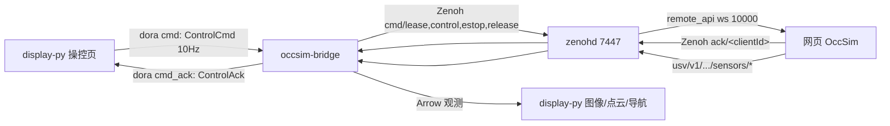

## 产品概述
给 OccSim 无人艇加一条"从显示端操纵、经桥接到网页仿真"的控制回路：桥接节点从 dora 输入端口接收控制指令，按网页要求的 Zenoh 租约协议下发，并把浏览器的受理结果回传给显示端。

## 核心功能
- **操纵页**：新增「操控」页面，提供油门/舵推杆、左右桨差动模式、停车、急停按钮；持续以 10 Hz 下发指令，界面实时显示回执状态（受理/拒绝及原因）与指令时效。
- **桥接控制出口**：桥接消费 `ControlCmd` 输入，校验后经 Zenoh `cmd/lease`、`cmd/control`、`cmd/estop`、`cmd/release` 下发；单包有效期 250 ms，10 Hz 上限限流。
- **回执回流**：浏览器 ACK 转成 `ControlAck` 输出端口，显示端据此判断"是否真的动起来"，而不是把"已发送"当成功。
- **失效保护**：上游静默 400 ms 自动释放控制权；数据流停止时尽力 release；网页暂停或状态过期时直接拒绝并给出原因。
- **临时令牌**：存放在 dataflow.yml 的桥接节点 env 中，程序启动时读取；重新生成数据流不丢失，日志与错误信息只输出令牌指纹。
- **默认不越权**：未配置令牌时控制功能整体关闭并告警一次，观测链路完全不受影响。

## 边界
不做 UDP 5005 入口、不做网页复位后的自动重连、不做航点/任务级控制（仅手动推杆）。


## 技术栈
- 桥接：Rust 2024 + `dora-node-api 1.1.0`（`arrow-v59`）+ `zenoh 1.10.1`，**无新增依赖**（control 复用 `main.rs` 已有的 zenoh session）。
- 显示端：Python 3.12 + PySide6 + pyarrow（沿用 `display-py` 现有结构与主题）。
- 协议：`types/usv/occsim/control/v1.yml`（已完成）定义 `ControlCmd` / `ControlAck`。

## 实现路径与关键决策

### 1. 数据流向
显示端产出 `ControlCmd` → dora `cmd` 输入 → 桥接（Zenoh 租约）→ 网页；浏览器 ACK → 桥接 `cmd_ack` 输出 → 显示端。端口命名避开 `__`：`cmd` / `cmd_ack`，防止 `kind_of()` 把端口误拆成观测 kind。

### 2. 令牌放置（用户指定：写在 dataflow.yml）
- 落点选**节点级 `env:`**（dora 1.1 支持 `env` 且节点覆盖顶层，值会注入子进程环境），而非 `args:`——避免出现在进程命令行、任务管理器与 `dora describe` 输出里。
- 程序侧只做一件事：`std::env::var("OCCSIM_PAIR_TOKEN")`。缺失或空 → 控制禁用，`warn` 一次，`cmd` 仍可接收但立即回 `rejected`。
- `gen-dataflow` 重新生成时必须**保留已有令牌**：读旧 `dataflow.yml` 的 `nodes[id=occsim-bridge].env.OCCSIM_PAIR_TOKEN`，未显式给出时原样写回；`--pair-token <T>` 覆盖，`--pair-token ""` 清除。
- 令牌只以指纹形式进日志（前 4 位 + 长度）；`zenohd` 子进程 spawn 时 `.env_remove("OCCSIM_PAIR_TOKEN")`，避免二次扩散。
- 风险与缓解写进 README：`dataflow.yml` 当前被 git 跟踪，含令牌时不要提交；换令牌 = 改 YAML 并重启数据流（该方案不提供热重载）。

### 3. 桥接语义：只转发、不保持
- 网页侧每包只生效 250 ms、停发 350 ms 自动释放，因此**必须由上游持续发**；桥接只做 ≤10 Hz 限流与合法化，不做"记住最后指令无限重发"，否则控制器崩溃会让艇继续跑。
- 静默判定：超过 400 ms 未收到 `cmd` → 主动 `release` 并回一条 `rejected`/`released` 状态；`estop` 立即下发并放弃租约，恢复需显式新指令。

### 4. 线程模型（不阻塞观测）
- 现有 `pipeline::run` 单主循环负责观测发送与 `&mut node`；控制链路的 ACK 等待最长 0.8 s，**不能放在主循环**。
- 新增 `control::worker`：`tokio::spawn` 持有 `Link`，从 `tokio::sync::mpsc` 收 `Command`，内部 `lease → control → 等 ACK`，结果通过 `crossbeam_channel::bounded(64)` 回主循环；主循环 `try_send`/`try_recv`，满则丢并计数。
- 主循环负责 `node.send_output("cmd_ack", ...)`（`DoraNode` 需 `&mut`，不能跨线程）。

### 5. 输入解析
`Event::Input { id: "cmd", data: DoraArray }` → `data.as_array()` → downcast `StructArray` → 按列名取值（`kind` 必须是 `control/estop/release`；四个 Float64 取 `NaN` 视为未给；越界、混用 `throttle` 与 `port/starboard`、`control` 却无推进量，全部判非法并回 `rejected`）。

### 6. prefix 发现
启动时 `session.get("usv/v1/*/*/*/active")` 取 `prefix`：0 个 → 控制禁用并提示"网页未连接"；1 个 → 使用；多个 → 要求 `--run-prefix`。从 prefix 拆出 `instanceId`（第 3 段）与 `runId`（末段）。网页复位导致 `runId` 变化时**不做自动重连**（v1 边界），拒绝原因回传面板。

### 7. 已知技术风险：Zenoh encoding
`EncodingBuilderTrait` 仅在 `zenoh` 的 `internal` feature 下导出，而 Cargo.toml 明确避免 `unstable/internal`。因此 **put 使用默认编码（`zenoh/bytes`），载荷仍为 UTF-8 JSON**；若联调发现网页侧校验 encoding，再评估局部启用 `internal`（会改变整个 zenoh 依赖的 feature 集），该结论写入 README 排错表。

## 系统架构



## 目录结构

```
occsim-dora-rs/
├── src/
│   ├── control.rs                  # [NEW] 控制链路核心。
│   │                               #   1) CommandKind/Command 定义 + parse_command(&dyn Array)：
│   │                               #      按列名读 kind/throttle/steering/port/starboard，
│   │                               #      NaN 归一化为 None，校验范围 [-1,1]、推进二选一、
│   │                               #      control 必须有推进量；返回 Err(String) 作为拒绝原因。
│   │                               #   2) token_fingerprint()：日志脱敏（前 4 位 + 长度）。
│   │                               #   3) Link：持有 session/prefix/client_id/lease_id/token；
│   │                               #      订阅 <prefix>/state（simTime, paused, seen_at）与
│   │                               #      <prefix>/ack/<client_id>；issue() 用 requestId 配对、
│   │                               #      800ms 超时；submit() 实现 state 新鲜度 0.7s/paused 检查、
│   │                               #      lease→control(validUntil=simTime+0.25)→estop 后弃租约。
│   │                               #   4) discover_prefix()：get usv/v1/*/*/*/active，0/多实例报错。
│   │                               #   5) worker()：tokio 任务，收 Command 回 Ack，含 10Hz 限流、
│   │                               #      400ms 静默 release、Drop 时尽力 release。
│   ├── main.rs                     # [MODIFY] 新增 --control、--pair-token <T>、--run-prefix <P>；
│   │                               #   读取 OCCSIM_PAIR_TOKEN 并在启动时打一次指纹日志；
│   │                               #   gen-dataflow 分支把 ControlOptions 传给 dataflow_gen::render；
│   │                               #   zenohd spawn 前 env_remove 该变量；pipeline::run 增加控制参数。
│   ├── pipeline.rs                 # [MODIFY] 主循环新增：Event::Input(id=="cmd") → parse → try_send 给
│   │                               #   worker；try_recv Ack → node.send_output("cmd_ack", encode_ack)；
│   │                               #   静默计时与 stop 时 release；保持观测发送路径不变。
│   ├── encode.rs                   # [MODIFY] 新增 encode_ack(&Ack) -> ArrayRef（StructArray：
│   │                               #   status/kind/reason 三个 Utf8），与 control/v1.yml 的
│   │                               #   ControlAck 逐字段对齐；补契约测试。
│   └── dataflow_gen.rs             # [MODIFY] 新增 ControlOptions { enabled, token }；
│   │                               #   bridge 节点追加 inputs: cmd: occsim-display/cmd +
│   │                               #   input_types: cmd: usv/occsim/control/v1/ControlCmd，
│   │                               #   outputs 追加 cmd_ack + output_types；
│   │                               #   display 节点追加 outputs: [cmd] + output_types 与
│   │                               #   inputs: cmd_ack: occsim-bridge/cmd_ack；
│   │                               #   令牌以 env: OCCSIM_PAIR_TOKEN 写入 bridge 节点（无令牌则不写）；
│   │                               #   另提供 carry_over_token(old_yaml, new_yaml) 供 main 保留旧值。
├── display-py/
│   ├── app/
│   │   ├── control.py              # [NEW] ControlCmd 的 Arrow 构造（kind Utf8 + 4×Float64，缺省 NaN）
│   │   │                           #   与 ControlAck 解析；纯函数，便于 smoke_test 直接断言。
│   │   ├── node_worker.py          # [MODIFY] 新增 send_command(payload)：UI 线程只入队
│   │   │                           #   （queue.SimpleQueue），QThread 内每轮 drain 后
│   │   │                           #   node.send_output("cmd", array)，Node 仍只在工作线程使用。
│   │   ├── panels/control_panel.py # [NEW] 操控页：油门/舵滑块、差动模式双滑块、停车/急停按钮、
│   │   │                           #   回执卡片（status/reason/最近受理时刻/发送计数）；
│   │   │                           #   10 Hz QTimer 发送，值未变化也发（维持 250ms 有效期）。
│   │   ├── panels/__init__.py      # [MODIFY] 注册 ControlPanel。
│   │   └── window.py               # [MODIFY] 新增第 5 个页签；_drain 在 kind 分派前单独拦截
│   │                               #   port == "cmd_ack" 交给控制面板；把 worker 的发送接口暴露给面板。
│   └── tests/smoke_test.py         # [MODIFY] 断言 ControlCmd 结构、操控页构建、注入伪造 cmd_ack 后
│                                   #   面板状态更新，且不影响现有图像/点云断言。
├── dataflow.yml                    # [MODIFY] 重跑 gen-dataflow 生成（含 cmd/cmd_ack 接线与令牌 env 示例）。
├── types/usv/occsim/control/v1.yml # [已有] 控制协议定义。
└── README.md                       # [MODIFY] 新增「控制链路」章节：端口与类型表、令牌放置位置与
                                    #   泄漏风险、启停顺序、10Hz/250ms/400ms 时序、encoding 与排错表。
```

## 关键代码结构

dataflow.yml 中令牌与接线的目标形态：

```yaml
nodes:
  - id: occsim-bridge
    path: "target/release/occsim-dora-rs.exe"
    env:
      OCCSIM_PAIR_TOKEN: "网页「接入程序」里的临时令牌"
    inputs:
      tick: dora/timer/millis/50
      cmd: occsim-display/cmd
    input_types:
      cmd: usv/occsim/control/v1/ControlCmd
    outputs: [..., cmd_ack]
    output_types:
      cmd_ack: usv/occsim/control/v1/ControlAck
  - id: occsim-display
    outputs: [cmd]
    output_types:
      cmd: usv/occsim/control/v1/ControlCmd
    inputs:
      cmd_ack: occsim-bridge/cmd_ack
```

桥接侧命令模型（实现契约）：

```rust
pub enum CommandKind { Control, Estop, Release }

pub struct Command {
    pub kind: CommandKind,
    pub throttle: Option<f64>,   // NaN -> None
    pub steering: Option<f64>,
    pub port: Option<f64>,
    pub starboard: Option<f64>,
}

/// 非法组合一律返回 Err(reason)，由调用方回 rejected。
pub fn parse_command(array: &dyn arrow::array::Array) -> Result<Command, String>;
```

## 实现注意事项
- **不回归**：观测链路（decode→encode→send_output、8 类端口、ports.yaml 路由、图像 metadata、三维点云、雷达伪彩）零改动；现有 25 单测 + 8 parity + `smoke_test.py` 必须继续通过，`dora validate dataflow.yml` 必须继续 OK。
- **性能**：控制是低频小载荷（10 Hz、十余个字段），限流后对观测无影响；ACK 等待只在 worker 内，主循环轮询间隔保持 2 ms。
- **日志**：`info` 只打"控制已启用（prefix=…，token=abc1…12）"、每次 rejected 一条；accepted 按 5 s 汇总，避免 10 Hz 刷屏；任何路径不得输出明文令牌。
- **失败可解释**：`rejected` 原因直接复用网页语义（无新鲜 state / 暂停中 / 令牌无效 / 已被他人控制 / ACK 超时），显示端原样展示，便于现场定位。
- **blast radius**：新增代码集中在 `control.rs` 与两个端口；`pipeline.rs` 的观测分支不改动，控制路径任何异常都不得中断数据流。

